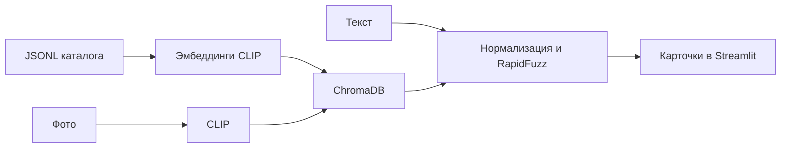

# SmartSearch_LMpro

Эксперимент с поиском строительных товаров из каталога Лемана ПРО по фотографии,
названию и сочетанию фото с текстом. Результат — карточки с изображением, ценой
и ссылкой на товар.

**Статус: активная разработка остановлена.** Исходники сохранены как эксперимент
с мультимодальным retrieval. Качество поиска не прошло количественную оценку;
измеренные метрики retrieval пока не представлены. Исходники сохранены для изучения
подхода и его ограничений.

## Что реализовано

- Парсинг категорий и карточек товаров в JSONL.
- Подготовка эмбеддингов и локального индекса ChromaDB (`lemana_products`).
- Поиск по фотографии через `openai/clip-vit-base-patch32`.
- Текстовые CLIP-эмбеддинги после перевода запроса; морфологическая нормализация
  `pymorphy3` и RapidFuzz для дополнительного ранжирования по названию.
- Гибридный поиск: перевод русского запроса на английский, взвешивание текстового
  и визуального CLIP-эмбеддингов, дополнительное ранжирование по названию.
- Streamlit-интерфейс с загрузкой фото и выводом карточек.

Описание относится к сохранённой Git-версии прототипа. При запросе только текстом
движок ищет дополнительную картинку через DuckDuckGo и запускает гибридный поиск.
Генерирующей LLM в поиске нет.



## Структура

```text
src/parser/                  сбор каталога
src/embeddings/embeddings.ipynb  подготовка эмбеддингов
src/db/build_image_db.py      сборка ChromaDB из массивов
src/main/search_engine.py    поисковый движок
src/main/app.py              Streamlit
data/                       локальные данные и индекс
```

## Просмотр прототипа

Python 3.12+, зависимости — `pyproject.toml` / `uv.lock`.

```bash
uv sync
uv run streamlit run src/main/app.py
```

До запуска нужна локальная ChromaDB в `data/chroma_db/` с коллекцией
`lemana_products`. Данные и индекс не поставляются с чистым клоном.
Для восстановления индекса нужны `data/lem_products.jsonl`, согласованные
массивы `data/embeddings/emb_*.npy` и `idx_*.npy`, подготовленные ноутбуком
на том же каталоге и в том же порядке. Затем из корня проекта:

```bash
uv run python src/db/build_image_db.py
```

Сборщик использует `collection.add`: повторный импорт тех же ID не является
процедурой обновления индекса. При старте движок загружает CLIP; гибридный поиск
также зависит от внешнего сервиса перевода; запрос текстом — от поиска DuckDuckGo.

## Известные ограничения

- Нет размеченного набора запросов и измерений Recall@K / Precision@K.
- Общий CLIP может находить визуально похожие товары с другим назначением.
- Фильтр по отделу в UI требует `department` в метаданных; текущий сборщик
  `build_image_db.py` это поле не записывает. Такой фильтр с этим индексом
  использовать нельзя.
- Интерфейс сохранённой Git-версии требует текст даже при загрузке фото, хотя
  движок имеет отдельный режим поиска только по изображению.
- При запросе только текстом дополнительное изображение из DuckDuckGo может
  ухудшать релевантность. Если изображение не получено, корректный fallback не реализован.
- Качество зависит от перевода запроса и морфологического ранжирования.
- Парсер зависит от структуры стороннего сайта; актуальность цен не гарантируется.

Дальнейшая разработка не запланирована. Код и история эксперимента сохранены.
